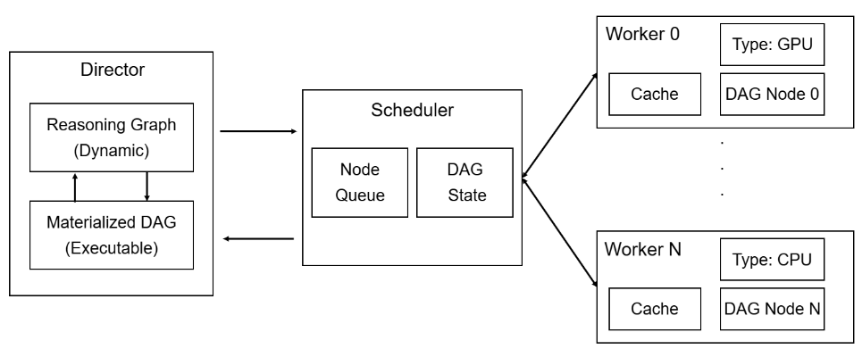

# Wenbo

[](https://www.python.org/) [](LICENSE) [](https://www.preprints.org/manuscript/202611.0942) [](https://wenbo.readthedocs.io/en/latest/index.html)

Wenbo is an event-driven scheduler for multiple DAG-shaped LLM workflows with bounded concurrency. It provides dependency tracking, logical resource slots, pluggable scheduling policies, execution backends, and runtime records.

## Features

Wenbo addresses resource fragmentation in large-scale agent serving by dynamically scheduling individual computation nodes across shared GPUs and CPUs, preserving task dependencies while improving resource utilization and throughput.

- **DAG-centric agent execution:** Represent reasoning and computation steps as nodes with explicit dependencies, exposing parallelism within and across agent tasks.
- **Dynamic reasoning graphs:** Incrementally materialize executable DAG flows and refine the reasoning graph as intermediate results become available, as described in the paper design.
- **Global dependency-aware scheduling:** Coordinate ready nodes across active DAGs and dispatch them according to their resource requirements and worker availability.
- **Shared GPU/CPU resources:** Allocate resources to individual computation nodes, allowing operations from different tasks to share heterogeneous resources without reserving a fixed resource pair for each task's lifetime.
- **Decoupled system architecture:** Separate reasoning orchestration (Director), resource scheduling (Scheduler), and node execution (Workers).

## Architecture



Wenbo separates reasoning orchestration, global node scheduling, and heterogeneous execution through the Director, Scheduler, and Workers.

## System and benchmark

This repository contains the Wenbo workflow runtime. The independent [ARGB repository](https://github.com/wenbo-project/ARGB) maintains the paper datasets, discrete-event simulator, baselines, and experiments. The Quick Start below launches an ARGB experiment in an isolated subprocess.

Both distributions use the import name wenbo. Keep benchmark development in a separate environment; the Quick Start runs its source checkout directly and does not require installing the benchmark distribution.

## Quick start

Requires **Python 3.10 or newer**. Clone the system repository and create a virtual environment:

```bash
git clone https://github.com/wenbo-project/wenbo.git
cd wenbo
python -m venv .venv
```

Activate it on macOS / Linux:

```bash
source .venv/bin/activate
```

Or on Windows PowerShell:

```powershell
.venv\Scripts\Activate.ps1
```

Install Wenbo, obtain the benchmark checkout, and run the experiment:

```bash
python -m pip install -e .
git clone https://github.com/wenbo-project/ARGB ../benchmark
python -u examples/quickstart.py --benchmark-root ../benchmark
```

If you already have either checkout, use its existing directory. The benchmark must include the matching datasets and support --profile quickstart; see the [setup requirements](docs/quickstart.md#prepare-the-environment-and-benchmark).

The default run compares Wenbo with the Flash-Searcher baseline on StrategyQA, MuSiQue, ToolBench, and ALFWorld. It uses discrete-event virtual time and requires no physical GPU, model download, or API key.

The terminal reports throughput, resource utilization, and speedup. Reports are saved to .local/quickstart-gpu2-cpu16/; reusing an output directory overwrites its reports. For a smaller first run:

```bash
python -u examples/quickstart.py --benchmark-root ../benchmark --limit 3 --seeds 11 --output-dir .local/paper-smoke
```

See the [Quick Start guide](docs/quickstart.md) for the experiment protocol, command-line options, result validation, and troubleshooting.

## Documentation

Browse the [online documentation](https://wenbo.readthedocs.io/en/latest/) or use the source guides below.

| Topic | Guide |
| --- | --- |
| Run the four-dataset paper experiment | [Quick start](docs/quickstart.md) |
| Repository responsibilities and experiment protocol | [Paper experiments](docs/experiments/real-datasets.md) |
| Build and run a workflow in Python | [System usage](docs/user-guide/workflows.md) |
| JSON workload fields | [DAG format](docs/dag-schema.md) |
| Components and source directories | [Introduction](docs/introduction.rst) |


## License

Released under the [MIT License](LICENSE).

## Citation

If you use Wenbo in your research, please cite:

```bibtex
@article{202611.0942,
  doi = {10.20944/preprints202611.0942.v1},
  url = {https://doi.org/10.20944/preprints202611.0942.v1},
  year = {2026},
  month = {November},
  publisher = {Preprints},
  author = {Feiyang Chen and Junqing Yang and Wentao Zhang and Zheng Wang and Li Pan and Jianhua Li},
  title = {Wenbo: Scaling Agent Reasoning via Dynamic DAG Scheduling},
  journal = {Preprints}
}
```
