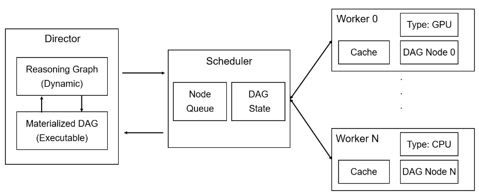

Introduction
============

What is Wenbo?
--------------

Wenbo is an event-driven scheduling runtime for multi-agent reasoning
workloads. It represents each workflow as a directed acyclic graph (DAG),
where nodes are independently schedulable units of work and edges define the
dependencies between them.

Wenbo coordinates all admitted DAGs through a shared scheduling loop. It
tracks dependency state, selects ready nodes according to a configurable
policy, places them on compatible CPU or GPU workers, and records the
resulting execution timeline.

Why Wenbo?
----------

Agent workflows commonly combine GPU-intensive model inference with
CPU-intensive retrieval, tool execution, and data processing. When an entire
workflow is bound to a fixed set of resources, one device can remain idle
while another becomes a bottleneck. Running multiple workflows independently
can further increase resource fragmentation.

Wenbo decouples workflow progress from worker allocation. Ready nodes from
all active DAGs enter a shared scheduling domain and are dispatched only when
their dependencies and resource requirements are satisfied. This approach
improves resource utilization, increases throughput for mixed CPU/GPU
workloads, and allows scheduling policies to operate across workflow
boundaries.

Architecture
------------

Wenbo separates workload orchestration, global scheduling, and node execution
into three primary components:

.. list-table::
   :header-rows: 1
   :widths: 24 76

   * - Component
     - Responsibility
   * - Director
     - Validates and normalizes an executable DAG before admitting it to the
       runtime. The current implementation accepts an already materialized
       DAG at this boundary.
   * - Scheduler
     - Tracks DAG state, maintains the global set of ready nodes, applies the
       configured policy, and dispatches work within concurrency limits.
   * - Workers
     - Execute nodes on compatible CPU or GPU resources through a pluggable
       backend and report completion or failure to the runtime.

After a DAG is admitted, its dependency-free nodes become ready for
scheduling. The Scheduler selects ready nodes and assigns them to compatible
Workers. Each completion updates the DAG state and unlocks newly eligible
successors. This event-driven cycle continues until the DAG succeeds, fails,
or is cancelled.

Core Capabilities
-----------------

Wenbo currently provides:

* **Multi-DAG Execution:** Runs multiple DAGs through one event-driven runtime
  while tracking the state and dependencies of each workflow.
* **Resource-Aware Placement:** Matches CPU, GPU, and hardware-agnostic nodes
  to workers with compatible capabilities.
* **Pluggable Scheduling Policies:** Includes FIFO, priority,
  shortest-job-first, fair round-robin, and fair shortest-job-first policies.
* **Controlled Concurrency:** Enforces execution limits through an in-process
  worker pool and explicit worker leases.
* **Execution Reliability:** Supports node timeouts, cancellation, failure
  propagation, and configurable retries.
* **Dependency Output Resolution:** Makes completed upstream outputs available
  to downstream prompts during execution.
* **Operational Observability:** Records lifecycle events, scheduling
  decisions, resource activity, and execution timelines.
* **Workload Evaluation:** Provides synthetic workload support, HotpotQA
  conversion, and deterministic discrete-event simulation for scheduling
  experiments.
